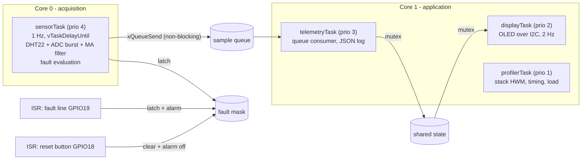

# Smart Environmental & Predictive Maintenance Edge Node

A real-time fault-monitoring firmware for a **dual-core ESP32**, built on **FreeRTOS** (Arduino framework, C++).
Deterministic 1 Hz sensor acquisition runs on **Core 0**, isolated from OLED rendering, JSON telemetry and
diagnostics on **Core 1**. Faults are latched by hardware interrupts for low-latency alarm response.

## Features

- **Task pinning across both cores** with `xTaskCreatePinnedToCore`
- **Deterministic 1 Hz acquisition** using `vTaskDelayUntil` (no drift), with measured wake-up jitter
- **Thread-safe data flow**: FreeRTOS queue (Core 0 -> Core 1) and mutexes (shared state, serial output)
- **Moving-average ADC filtering** of a simulated vibration sensor
- **GPIO hardware interrupts (ISRs)** for external fault latching and manual alarm reset, with debounce
- **Environmental sensing**: DHT22 temperature and humidity
- **I2C SSD1306 OLED** status display and **JSON telemetry** over serial
- **RTOS diagnostics profiler**: `uxTaskGetStackHighWaterMark()` stack report and microsecond `esp_timer`
  execution timing per task, used to right-size stacks and check dual-core load balance

## Architecture



| Task | Core | Priority | Period | Purpose |
|---|---|---|---|---|
| `sensor` | 0 | 4 | 1000 ms | Read DHT22 and ADC, filter, evaluate faults, enqueue sample |
| `telemetry` | 1 | 3 | event (queue) | Update shared state, print JSON line |
| `display` | 1 | 2 | 500 ms | Render OLED |
| `profiler` | 1 | 1 | 10 s | Print diagnostics report |

The sensor task never blocks on the queue: if it is full, the sample is dropped and counted (`queue_drops`),
so acquisition timing is never affected by slow consumers.

## Hardware / pin map

| Signal | ESP32 pin | Notes |
|---|---|---|
| DHT22 data | GPIO15 | |
| Vibration (simulated) | GPIO34 | Potentiometer on ADC1, 12-bit, 11 dB attenuation |
| OLED SDA / SCL | GPIO21 / GPIO22 | SSD1306 128x64, address 0x3C |
| Alarm LED | GPIO2 | Through 220 ohm resistor |
| Buzzer | GPIO4 | |
| Reset button | GPIO18 | Active low, falling-edge ISR |
| External fault line | GPIO19 | Active low, falling-edge ISR (simulates a hardware comparator / e-stop) |

## Fault logic

| Fault | Condition (see `include/config.h`) | Detected by |
|---|---|---|
| `TEMP` | temperature >= 40 C | sensor task |
| `HUM` | humidity >= 85 % | sensor task |
| `VIB` | filtered ADC >= 3000 (of 4095) | sensor task |
| `EXT` | falling edge on GPIO19 | **ISR** (latched immediately) |
| `SENS` | 5 consecutive DHT22 read failures | sensor task |

Faults are **latched**: they stay set, and the LED and buzzer stay on, until the reset button (GPIO18) is pressed.
The reset ISR clears the mask directly. If the condition is still present, the sensor task re-latches it on its next cycle.
The fault mask and alarm outputs are updated under one spinlock so a reset ISR can never leave the alarm on with no fault set.

## Build and run

### PlatformIO (hardware)
```bash
pio run                 # build
pio run -t upload       # flash
pio device monitor      # 115200 baud
```

### Wokwi (simulation)
1. Install the **Wokwi for VS Code** extension (or use the Wokwi CLI).
2. Run `pio run` to build the firmware.
3. Open the project and choose **Wokwi: Start Simulator**. `diagram.json` and `wokwi.toml` are included.

### Try the faults in simulation
- Click the DHT22 and set temperature above 40 C -> `TEMP` latches, LED and buzzer turn on.
- Turn the potentiometer up -> `VIB` latches once the filtered value passes 3000.
- Press the FAULT button -> `EXT` latches immediately from the ISR.
- Press the RESET button -> alarm clears (and re-latches next second if the condition persists).

## Serial output

Telemetry (one JSON object per line, easy to parse):
```json
{"seq":12,"t_ms":12004,"temp_c":25.0,"hum_pct":45.0,"vib_raw":1180,"vib_filt":1176,"faults":0,"fault_names":"NONE","dht_ok":true}
```

Diagnostics report every 10 s (format example; values depend on your build and hardware):
```
[PROF] ---- window 10000 ms ----
[PROF] sensor    n=10 exec_us min/avg/max = ...
[PROF] telemetry n=10 exec_us min/avg/max = ...
[PROF] display   n=20 exec_us min/avg/max = ...
[PROF] sensor wake-up jitter max = ... us
[PROF] busy approx: core0 = ... %  core1 = ... %
[PROF] stack sensor    core0 size=3072 used=... (...%) min_free=...
[PROF] heap free=... min_free=... | queue_drops=0 | isr fault=0 reset=0
```

### Right-sizing stacks
Run the node for a few minutes, trigger every fault path, then read the `stack` lines. Set each
`STACK_*` value in `include/config.h` to roughly the observed usage plus a safety margin (about 25-30 %),
and re-check after every feature change.

## Design notes and limitations

- **Load figures are approximate.** "Busy %" is wall-clock time spent inside each task's work section, so it
  includes time spent preempted or waiting on I2C. It is a balance indicator, not a true CPU-time counter.
- **DHT22 reads briefly mask interrupts** (its protocol is bit-banged with timing-critical sections of a few ms),
  which can slightly delay an ISR that fires during a read. A hardware-timer or RMT based driver would remove this.
- The vibration input is a potentiometer on a single ADC channel. A real build would use an accelerometer
  (for example over I2C/SPI) and compute RMS or FFT features over a sample window.
- Thresholds are fixed constants. Persisting them in NVS and exposing them over serial or Wi-Fi are natural next steps.

## Possible extensions
- MQTT / HTTP telemetry on Core 1
- Accelerometer (MPU6050 / ADXL345) with RMS and FFT-based condition monitoring
- NVS-stored thresholds and a fault log
- Unit tests for the filter and fault logic using PlatformIO's native test environment

## Project layout
```
include/   config.h  types.h  faults.h  profiler.h  moving_average.h
src/       main.cpp  faults.cpp  profiler.cpp
platformio.ini   diagram.json   wokwi.toml
```
